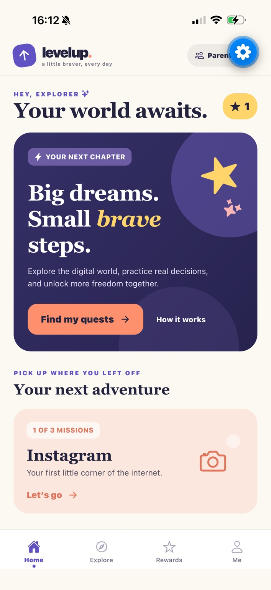
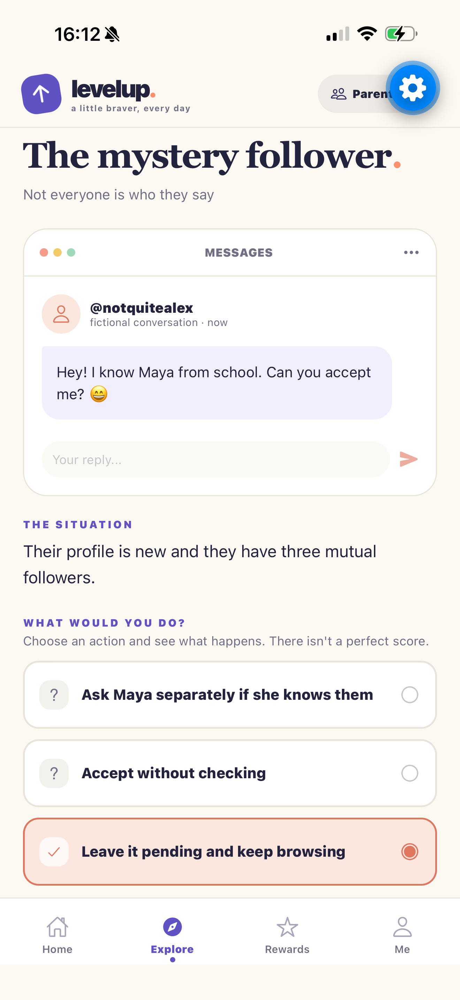
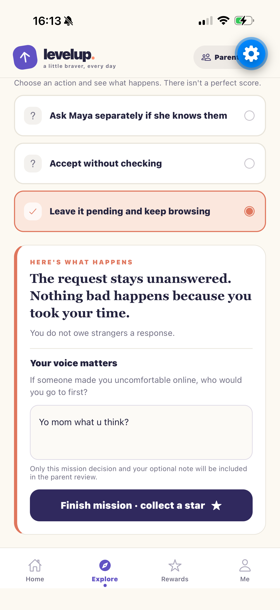
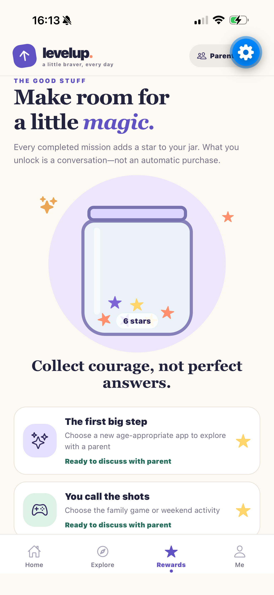

<div align="center">

# ✦ LevelUp

### Big dreams. Small *brave* steps.

**A little braver, every day.**

**What if getting your first app or phone started a conversation and not an argument?**

LevelUp turns everyday requests for digital freedom into interactive safety missions. Teens practice real-world decisions, reflect on their choices, and share what they learned. Parents review the journey and **make the decision together** without surveillance or a mystery readiness score.

**Explore a request → Complete missions → Share with a parent → Decide together → Collect stars**

</div>

---

## ✨ Who is LevelUp for?

| | Who | Why they'll use it |
|:--|:--|:--|
| 🧑‍🚀 | **Teens** | Practice navigating social media, games, AI and new devices — and show they can think through tricky situations. |
| 💜 | **Parents & guardians** | See the choices and reflections their teen *chooses to share*, then approve, pause, or suggest more practice. No spying required. |
| 🏫 | **Educators & youth programs** | Potential future use as guided digital-citizenship activities and family discussion starters. |

### From “Can I download it?” to “Let's figure it out.”

Choose from **8 digital-life adventures** like Instagram, Roblox, ChatGPT, a first phone, YouTube, Discord, online shopping, and online friendships. Each adventure has **3 missions** that explore privacy, boundaries, critical thinking, and help-seeking.

There are **no pass/fail scores**. Teens explain their thinking; parents make the final call. Completing missions adds stars to a playful rewards jar, while any real privileges or purchases remain family decisions.

---

## 📱 Inside the app

<table>
  <tr>
    <td align="center" width="50%"><strong>01 · Home</strong><br/><sub>Your world awaits. Pick up the next adventure.</sub><br/><br/></td>
    <td align="center" width="50%"><strong>02 · Missions</strong><br/><sub>Make a call in a realistic digital-life scenario.</sub><br/><br/></td>
  </tr>
  <tr>
    <td align="center"><strong>03 · Reflect & share</strong><br/><sub>Understand the outcome and add a note for a parent.</sub><br/><br/></td>
    <td align="center"><strong>04 · Rewards</strong><br/><sub>Every completed mission adds a star to the jar.</sub><br/><br/></td>
  </tr>
</table>

**The complete experience also includes:** an Explore library, a same-device Parent Review mode (approve / practice more / not right now), and a profile showing progress.

---

## 🚀 Run LevelUp on your phone

**Stack:** React Native · Expo · TypeScript · AsyncStorage  
**You need:** Node.js, an iPhone with **Expo Go**, and the LevelUp Expo project on your Windows laptop. **No emulator required.**

### Already installed? Start here

Open PowerShell:

```powershell
cd "C:\Sahithi\LevelUp-Starter\levelup-app"
npm.cmd install
npx.cmd expo start --tunnel --clear
```

Scan the QR code with your iPhone Camera and open it in **Expo Go**. Tunnel mode is helpful when local Wi-Fi blocks a direct connection.

### Installing the V3 redesign into an earlier LevelUp Expo project?

Extract the `LevelUp-V3` source folder and run **from that extracted folder**:

```powershell
powershell -ExecutionPolicy Bypass -File .\install-into-project.ps1 -ProjectPath "C:\Sahithi\LevelUp-Starter\levelup-app"
```

Then run the startup commands above **inside `levelup-app`**, the folder containing `package.json`. The V3 source folder is an upgrade package, **not** a standalone Expo project.

### Quick demo route

1. **Explore → Instagram**: complete the three missions.
2. Add optional reflections and tap **Share with parent**.
3. Switch to **Parent view**; read the decisions and choose **Approve**, **Suggest more practice**, or **Not right now**.
4. Return to **Rewards** to see the star jar; visit **Me** for your progress.

